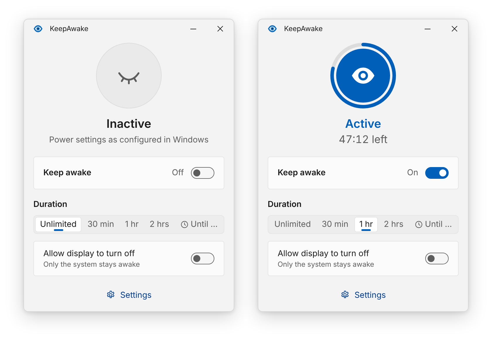
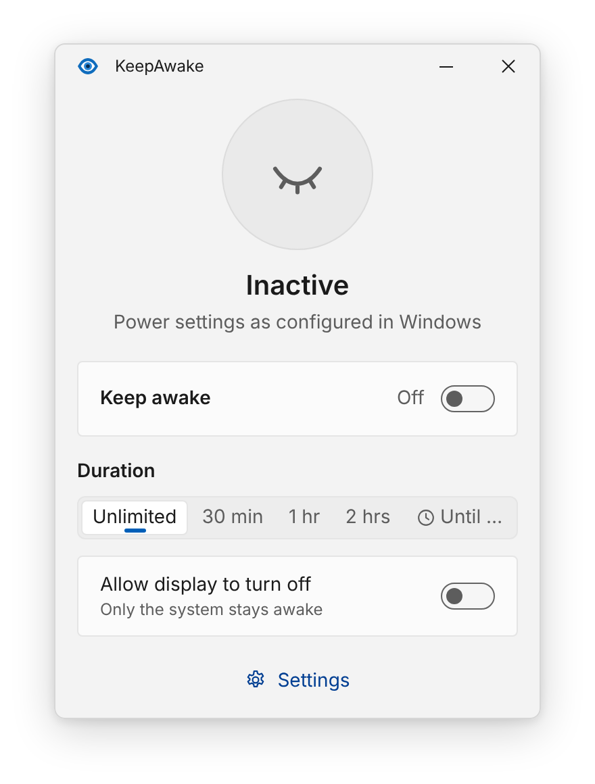
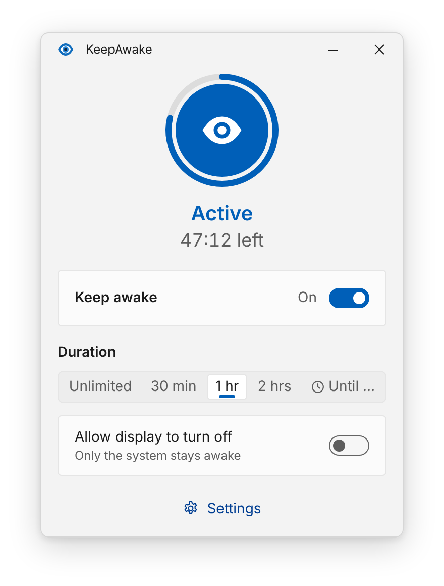
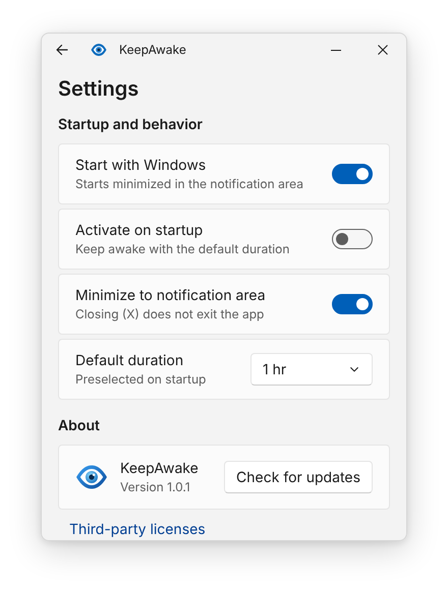
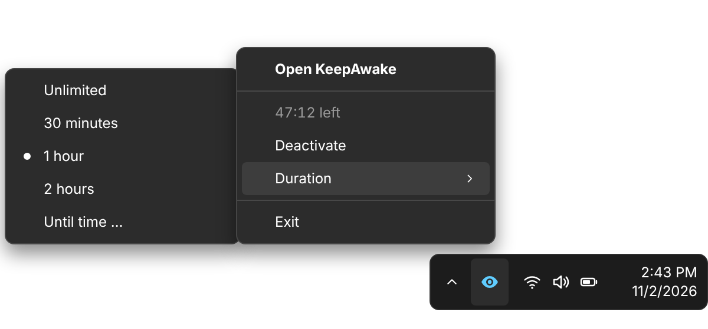

KeepAwake

**Keep your Windows PC awake. No mouse jiggling, no fake key presses.**

KeepAwake stops your PC from going to sleep, turning off the display or starting the screen saver, for as long as you want. One click in the notification area, and your PC stays on during that long download, presentation or remote session.

<p align="center">
  <picture>
    <source media="(prefers-color-scheme: dark)" srcset="images/hero-dark.png">
    
  </picture>
</p>

<p align="center">
  <a href="../../releases/latest"><strong>Download the latest version</strong></a>
</p>

---

## How it works

Many "stay awake" tools move your mouse or press invisible keys every few seconds. KeepAwake does **neither**.

- **No mouse movement.** Your cursor stays exactly where you left it.
- **No keyboard input.** Nothing is typed, nothing is pressed, nothing can end up in the wrong window.
- **The official way.** KeepAwake uses the Windows Power Request API, the same mechanism a video player uses to keep the screen on while you watch a movie.
- **Transparent.** You can always see what KeepAwake is doing. Open a terminal as administrator and run:

  ```
  powercfg /requests
  ```

  While KeepAwake is active, it shows up there with a short note such as *"KeepAwake: active until 17:30"*.
- **Clean exit.** When you turn KeepAwake off or quit it, Windows immediately goes back to your normal power settings.

## Features

- **One switch.** Turn it on, turn it off. That's it.
- **Pick a duration.** Unlimited, 30 minutes, 1 hour, 2 hours, or until a specific time of day, with a live countdown.
- **Keep the display on, or not.** Turn on *Allow display to turn off* if you only need the PC to keep running (for example for a download) and the screen may go dark.
- **Lives in the notification area.** Left-click the eye icon to toggle, right-click for the menu. A closed eye means inactive, an open eye means active.
- **Starts with Windows** if you like, and can activate itself automatically with your default duration.
- **Looks like Windows 11.** Light and dark mode, your accent color, Mica background.
- **English and German.** Follows your Windows display language.
- **Updates itself** with one click in the settings.

## Screenshots

| Inactive | Active with countdown | Settings |
|:---:|:---:|:---:|
|  |  |  |

<p align="center">
  
</p>

## Installation

1. Download **`KeepAwake-win-Setup.exe`** from the [latest release](../../releases/latest).
2. Run it. KeepAwake installs for your user account only, **no administrator rights needed**, and starts right away.

**"Windows protected your PC"?** KeepAwake is not code-signed yet, so Windows SmartScreen may show a warning the first time. Click **More info**, then **Run anyway**.

**Prefer no installation?** Download `KeepAwake-win-Portable.zip`, extract it anywhere and run `KeepAwake.exe`.

## Using KeepAwake

| You want to... | Do this |
|---|---|
| Turn it on or off | Left-click the eye icon in the notification area, use **Activate** / **Deactivate** in its menu, or use the switch in the window |
| Change the duration | Pick a duration in the window, or right-click the icon › **Duration** |
| Keep it running until a set time | Choose **Until …** and pick a time. A time that has already passed today means tomorrow. |
| Open the window | Right-click the icon › **Open KeepAwake** |
| Quit completely | Right-click the icon › **Exit** |

Closing the window with **X** keeps KeepAwake running in the notification area. You can change that in the settings.

> **Tip:** If you don't see the icon, click the small arrow **^** in the taskbar. You can drag the icon onto the taskbar to keep it always visible.

## Good to know

- **Sleep you trigger yourself still works.** Closing the laptop lid, pressing the power button or choosing *Sleep* from the Start menu behaves as usual.
- **Company PCs:** Some organizations lock the PC after a period without mouse or keyboard activity, as a security policy. KeepAwake does **not** bypass such policies, because it never simulates input. If your PC still locks, that's your IT department's setting.
- **Battery:** Keeping the display on uses more power. On a laptop, consider *Allow display to turn off* or a limited duration.

## Privacy

- No account, no ads, no tracking, no telemetry.
- KeepAwake only goes online when you click **Check for updates**. It then asks GitHub whether a new version exists.
- Your settings are stored locally in `%APPDATA%\KeepAwake\settings.json`.

## Updating

Open the window › **Settings** › **Check for updates**. If a new version is available, click **Install and restart**.

## Uninstalling

**Settings** (Windows) › **Apps** › **Installed apps** › **KeepAwake** › **Uninstall**.
The autostart entry is removed automatically. Your settings file in `%APPDATA%\KeepAwake` stays, delete the folder if you want to remove everything.

## Requirements

- Windows 11, 64-bit (x64)
- Windows 10 (version 2004 or later) may work, but is not tested

## Feedback

Found a bug or have an idea? [Open an issue](../../issues).

## License

KeepAwake is free to use. See [LICENSE](LICENSE) for details and [THIRD-PARTY-NOTICES](THIRD-PARTY-NOTICES.md) for the open-source components it includes.
